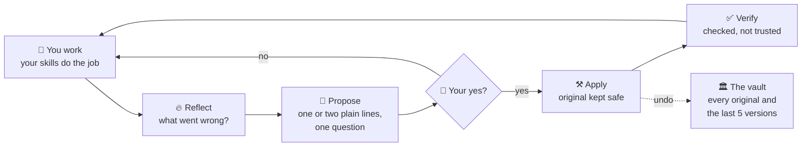

<div align="center">

# 💍 the-one-skill

### *One skill to tend them all, one skill to find them,*
### *one skill to mend them all, and never leave the old behind.*

**The skill that looks after all your other skills.**
It learns from every session, fixes what went wrong, keeps your roster lean,
and never loses an original. Every change waits for your yes, and every change can be undone.

[](https://github.com/mtfuller/the-one-skill/releases)
[](https://github.com/mtfuller/the-one-skill/actions/workflows/tests.yml)


</div>

---

## 🌄 The shadow over your skills folder

Skills are wonderful until you have a dozen of them. Then the trouble starts:

- 🔁 **You correct the same thing every week.** "Table, not prose." "Don't count the header." The skill never learns.
- 🐉 **Skills start fighting.** Two of them fire on every CSV, and three deck skills each carry their own copy of the brand rules, slowly drifting apart.
- 🕳️ **Edits go wrong quietly.** One stray edit and the version that worked is gone.
- 🧱 **New skills start from nothing**, even when Anthropic, OpenAI, or Google already published one that does most of the job.

**the-one-skill fixes all of this, and you never have to touch a file.** You talk about how things should *behave*. It handles skills, files, versions, and safety.

---

## 🗺️ The road goes ever on: how it works



Every change follows the same small road. It describes the change in plain words, waits for one yes, keeps the old version, applies the change, checks the result, and tells you how to undo it. Nothing happens behind your back.

---

## 🧝 What it can do for you

**There are no commands to learn.** Each row below is something you ask for in plain words, in any session where the-one-skill is installed. It works out which skills are involved, tells you the plan in a sentence or two, and waits for your yes.

| You want to… | Just say something like… | What happens |
| :--- | :--- | :--- |
| 🔥 **Fix a skill** that got something wrong | *"Reflect on this session."*<br/>*"Make csv-inspector use tables."* | It traces your corrections to the rule that caused them and proposes a fix |
| 🏰 **Tidy up** your skills | *"Review my skills."* | A short table of clashes, repeated rules, broken pieces, and idle skills, and what it would do about each |
| ⚒️ **Make a new skill** | *"Make a skill for this, I do it every week."* | A new skill built from the best published work, with tested scripts for the parts that must be exact |
| 🔌 **Use your connected tools** | *"Have my report skill use my task list."*<br/>(It also suggests this on its own.) | The skill reads from your calendar, tasks, or docs, and asks before changing anything there |
| 🏹 **Get a ready-made skill** | *"Find me an official skill for Terraform."* | Candidates from Anthropic, OpenAI, or Google only, each read in full before anything is installed |
| 🏛️ **Undo** a change | *"Undo that."*<br/>*"Back to vanilla."* | Exactly as much undone as you asked for, from one rule to everything |
| 🦅 **Update** the-one-skill | *"Here's a new release. Update yourself."* | The new version goes in, and your setup and your own improvements stay |

Two things you never have to ask for:
- 🧭 **Setup on first use.** The first time you ask it anything, it studies your host and offers a one-time setup that keeps your originals safe.
- ⚖️ **Rules it can't break.** A read-only policy that only you can change guarantees every promise in this README.

Each one is explained below. The Middle-earth name in *italics* next to each heading is just for fun.

---

### 🔥 Fix a skill that got something wrong · *the Hearth*

At the end of a journey, ask it to look back. It finds the skill that did the work, traces each of your corrections to the rule that caused it, and proposes a fix in plain words.

> **You:** Reflect on this session.
>
> **the-one-skill:** csv-inspector split `q1;q2;q3` into one column, because it assumes commas, and it wrote prose when you wanted a table.
> - It will detect the delimiter with a small tested script, which replaces its comma-only rule.
> - Summaries will always come back as a table, which replaces its rule to write prose.
>
> Apply both, one, or neither?
>
> **You:** Both.
>
> **the-one-skill:** Done. CSV summaries now come back as tables, in any delimiter. Say "undo" to reverse it. It applies from your next session.

- **Every overridden rule is named** before you agree, so nothing gets overwritten quietly.
- **Each rule goes where it belongs.** If the brand font is owned by `brand-style`, that's where the fix goes, not into the deck skill you happened to use.
- **Diffs only if you ask.** "Show me the diff" shows the exact change at once.

### 🏰 Tidy up your skills · *the Council*

> **You:** Review my skills.

You get a short table: each skill, what's wrong, and what it would do about it. Then one question: all, some, or none? It looks for:

- 🐉 **Clashing triggers.** Two skills that fire on the same request. The fix is a clear boundary ("Do not use for totals (use csv-summary)") or a merge.
- 📜 **Repeated procedure.** The same rules copied into several skills. This is the sneaky kind of overlap, because the skills never fire together and the copies still drift apart. A built-in checker compares every pair of skills on *what they do*, not just what triggers them, and spots copied instruction blocks and duplicated scripts. *"The brand rules appear in three skills; I'd move them into one `brand-style` skill the others point to."*
- 🌫️ **Vague descriptions** that never say when to use the skill.
- 🧱 **Broken structure:** missing files, files nothing mentions, scripts with no instructions for running them, leftover template text, descriptions Claude would reject, absolute paths into one machine, and scripts in a language your host can't run.
- 💤 **Idle skills:** on Claude Code it can read your session history (it asks once first) and lists skills nobody has used for two months. It never retires one without asking.
- 💡 **Gaps:** a workflow you keep repeating that no skill covers, and a few ideas for connected tools no skill uses yet.

It can **create, merge, split, rename, retire, restore**, and **extract a shared policy** into its own skill. Multi-skill changes are recorded as one *change set*, so a whole merge comes undone in one step. It keeps a **roster map** (which skill owns each job and each shared policy) so later reviews check against your decisions and don't ask twice.

### ⚒️ Make a new skill · *the Forge*

> **You:** Every Friday I write a status report from my notes: Done, Next, Blocked, at most 5 bullets each. Make a skill for it.

No forge starts cold. Before writing anything, it checks the skills already on your host and the ones **Anthropic, OpenAI, or Google** publish, and tells you where it's starting from:

| Start | When |
| :--- | :--- |
| 📦 **Install** | A verified skill already does the job |
| 🔧 **Adapt** | One does most of it. It's installed exactly as published, and your changes become a second version you can undo on their own |
| 🧩 **Borrow** | Verified skills solve parts of it, so the new skill takes their structure, steps, and scripts |
| ✨ **Scratch** | Nothing close exists |

Then it drafts the whole skill from a proven template (inputs, steps, output with an example, edge cases), filled in from **your actual corrections**.

**What must be exact is forged in code.** Instructions get followed slightly differently each run, and scripts run the same way every time. Counting, parsing, formatting, and validating go into small scripts. It tests each one on the real file from your session before proposing it, and writes it only in languages your host can run. (Hosts differ: one may run JavaScript, another only Python and bash. It records which ones are verified on each host.)

It remembers which published skills it has already read, so it doesn't search from scratch every time. A skill installed or adapted from a publisher can later take **the publisher's newer release**, and your tweaks stay.

### 🔌 Use your connected tools · *the Beacons*

> **You:** Have my report skill use my task list.

You can ask, but usually you don't need to: when it creates or improves a skill, it looks at what you've connected (calendar, tasks, mail, docs, issue trackers) and offers the tools that would feed the skill's work:

> **the-one-skill:** Your task board is connected. The report could also pull this week's completed tasks into Done, and your blocked tasks into Blocked. It would only read the board. Create it with the task board, or with notes only?

Skills built this way still work when a connector is missing, because they fall back to asking you. They read freely but **ask before sending, creating, or changing anything**, and they never copy your account details into a skill.

### 🏹 Get a ready-made skill · *aid from trusted realms*

> **You:** I keep correcting you on Terraform. Find me a verified skill for it.

It first names the corrections you keep making, then searches **only** skills that Anthropic, OpenAI, or Google publish, in their official repositories and their own products' skill directories. It compares each candidate against *your* corrections and says plainly if none covers everything. Before installing anything, it reads **every file** and tells you what the skill instructs, runs, and reaches over the network. A script that quietly phones home gets flagged.

That source list is fixed in the read-only policy. Nothing can widen it, not even a request. Skills from anywhere else, you install yourself.

### 🏛️ Undo a change · *the Vault*

The first change to any skill saves its **original, untouched forever**, plus its last five versions. You undo exactly as much as you ask for:

| Say | What happens |
| :--- | :--- |
| *"Remove the rule you added."* | Steps back one version, or removes just that rule. Nothing else changes |
| *"Put csv-inspector back how it was."* | Its original returns exactly. The improved version is still kept |
| *"Actually, bring the change back."* | The improved version returns |
| *"Undo the merge."* | The whole change set reverses in one step |
| *"Take everything back to vanilla."* | Originals return, retired skills are restored, created skills are retired, and it asks about anything you edited by hand |

Nothing is ever deleted. "Delete" means *retire*, which can always be reversed. Edits you made by hand are never overwritten.

### 🧭 Setup on first use, on any host · *map-making*

**Nothing to ask for.** It carries no maps for particular hosts, only the craft of drawing them. On its first run it studies your host with read-only checks. It never takes the host's word for what it can do, and never experiments on your real skills. Then it picks the safest way that host allows to keep originals:

| Host (typical) | How originals are kept |
| :--- | :--- |
| **Claude Code** | An exact copy in `.tos-store/` outside your skills folder, swapped in and out by a small Python helper, plus a **guard at the gate**: a hook that blocks direct edits to your skills, even in auto mode |
| **Gemini** | A *twin*: the original is disabled and never edited, and changes go into `<name>-tuned` |
| **ChatGPT** | A hand-off: you get two downloads per change, a backup of the skill as it was and the new version to upload |
| **Anything else** | Whatever its probes verify, from swap to backup to hand-off |

What it learns goes into `references/agentspace/`, the **Red Book** of your journeys: host maps, your preferences, the roster map, the verified skills it has read, and connector notes. Each new page is proposed to you first.

### 🦅 Update the-one-skill · *the Eagles*

When a new release comes out, hand it over and say *"update yourself."* It merges three ways: the release's changes go in, your own improvements stay, and your Red Book isn't touched. Any change to the read-only policy is called out on its own line. See [Upgrading](#-the-eagles-are-coming-upgrading) below.

### ⚖️ Rules it can't break · *the Rules*

**Nothing to ask for.** The skill can improve itself, using the same yes and undo as any other skill. What it may *never become* is fixed in `references/readonly-self-improvement.md`, a policy it cannot edit. Its eleven invariants include:

- 📜 originals are kept
- 🙋 nothing changes without your yes
- 🚫 no action is quietly swapped for another
- 🔍 results are checked, not trusted
- 🛡️ protected skills, connectors, and plugins stay untouched
- ♻️ nothing is deleted
- 🏹 outside skills come only from Anthropic, OpenAI, or Google, and are read in full first

Your notes can make these rules stricter, never looser. Only you change the policy, by hand.

---

## 🏡 Setting out: install and first run

**1. Install it**

| Host | How |
| :--- | :--- |
| **Claude Code** | Clone into `~/.claude/skills/the-one-skill` (all projects) or `.claude/skills/the-one-skill` (one project) |
| **Gemini, ChatGPT, others** | Download the release zip from [Releases](https://github.com/mtfuller/the-one-skill/releases) and upload it as a custom skill |

```bash
git clone https://github.com/mtfuller/the-one-skill ~/.claude/skills/the-one-skill
```

**2. Start the journey.** There's no setup command to remember. The first time you ask it anything, it sees a fresh install and offers a **one-time setup**: it maps your host, picks how to keep originals safe, and (on Claude Code) offers the guard. A good first request does setup and something useful at once:

> **You:** Review my skills.
>
> **the-one-skill:** *…a table of what it found…* This is the first run here, so it also needs a one-time setup that keeps an untouched copy of every skill, so any change can be undone. Expect a couple of permission prompts. Do the setup and these changes: all, some, or none?

On Claude Code you can also call it by name: `/the-one-skill set yourself up`.

---

## 🌱 Growing your skills: how to use it day to day

Your skills get better each time you use them. A rhythm that works:

| When | Say | What you get |
| :--- | :--- | :--- |
| 🌙 **After a session with friction** | *"Reflect on this session."* | The skill that caused the friction gets fixed, one yes |
| 🗣️ **Any time you know the fix** | *"Make csv-inspector always use tables."* | One sentence back confirming it, then your yes |
| 🔁 **When you repeat yourself** | *"Make a skill for this, I do it every week."* | A new skill, started from verified work, with scripts for the exact parts |
| 🧹 **Every few weeks** | *"Review my skills."* | Overlaps, repeated policies, idle skills, broken pieces, and connector ideas |
| 🧩 **When skills multiply** | *"Combine my deck skills into one."* | One merged skill, conflicts settled in the open, undoable in one step |
| 🏹 **When it's a common job** | *"Find me an official skill for spreadsheets."* | Candidates from the three trusted publishers, compared against your corrections |
| 📝 **To teach it about you** | *"Remember that I always want options as a table."* | A note in your Red Book, read in every session |
| 🔙 **When a change misfires** | *"Undo that."* / *"Back to vanilla."* | Exactly as much undone as you asked |
| 🧙 **When it gets in the way** | *"Improve the-one-skill: it asks too many questions."* | It improves itself, within the rules it can't break |

---

## 🦅 The eagles are coming: upgrading

1. **Download** the new release from [Releases](https://github.com/mtfuller/the-one-skill/releases): the `.zip`, or the single-file `the-one-skill-<version>.bundle.md` that any chat can read.
2. **Hand it over:**
   > **You:** Here's a new release of the-one-skill: `downloads/the-one-skill-1.1.0.bundle.md`. Update yourself.
3. **Read its report.** It reads every file, then tells you in a few lines what's new, which of your own improvements stay, and anything that changes in the read-only policy. One yes applies it.
4. **Refresh the map.** If the release teaches new host checks (for example, which script languages your host runs), it offers to refresh your setup notes.

Changed your mind? *"Undo the update"* puts the previous version back. Your Red Book is never touched by an update.

---

## 📖 The spellbook: quick reference

```text
🔥 Reflect        "Reflect on this session."              "That skill got the format wrong again, fix it."
🗣️ Change         "Make <skill> do X."                     "Show me the diff."
⚒️ Create         "Make a skill for this; I do it weekly."
🏰 Review         "Review my skills. Which ones overlap?"
🧩 Reshape        "Merge these two."   "Split this skill."   "Rename it."   "Pull the brand rules into one skill."
💤 Retire         "Retire the old report skill."           "Bring it back."
🏹 Find           "Find me a verified skill for Terraform."
🔌 Connect        "Have my report skill use my task list."
🏛️ Undo           "Undo that."   "Remove the rule you added."   "Put it back how it was."   "Back to vanilla."
📝 Remember       "Remember that I always want tables."
🦅 Update         "Here's a new release of the-one-skill. Update yourself."
🧙 Self-improve   "Improve the-one-skill: it asks too many questions."
```

---

## 🔧 Under the mountain: for the curious

<details>
<summary><b>📂 Layout</b></summary>

```
SKILL.md                                  the always-on core: start, routing, how to talk, hard rules
references/readonly-self-improvement.md   read-only policy: tiers, invariants, self-change procedure
references/building-adapters.md           framework: probe a host, choose a strategy, write adapters, keep the index
references/improving.md                   reflect on a session and improve skills
references/writing-skills.md              how to write a skill: description, sections, scripts, connectors
references/managing-roster.md             review, orthogonality, create, find and install, merge, retire, restore
references/undoing.md                     step back, undo change sets, back to vanilla
references/updating.md                    update the-one-skill from a downloaded release
references/agentspace/index.md            map of agentspace (ships empty; filled in on your system)
references/agentspace/*                   adapters and your notes (generated on your system, git-ignored)
scripts/skillctl.py                       store & swap helper (Python 3 stdlib, no installs)
scripts/overlap.py                        overlap in triggers, procedure, and scripts
scripts/guard_skills.py                   Claude Code hook: blocks direct edits inside skills folders
scripts/bundle.py                         pack a release into one text file (no agentspace), or unpack it
scripts/release.sh                        check, tag locally, and build the release files into dist/
VERSION.md, CHANGELOG.md                  release number and plain-language notes
tests/                                    unit tests for the scripts
evals/checklist.md                        manual checks to run on a host before a release
evals/headless/                           scripted Claude Code scenarios (claude -p), with a fake connector
```
</details>

<details>
<summary><b>🛠️ <code>skillctl.py</code>: the store & swap helper</b></summary>

You never need to run this yourself; the-one-skill does, after your yes. For reference:

```bash
python3 scripts/skillctl.py --root <skills_folder> <command>
```

| Command | What it does |
| :--- | :--- |
| `list [--json] [--languages python,bash]` | Every installed skill, its state, and structural problems (including scripts the host can't run) |
| `overlap [--candidate <skill\|folder>] [--also <folder>…]` | Overlap in triggers, procedure, and scripts across skills; `--also` adds read-only folders |
| `status` | Skills the-one-skill manages: `original`, `tuned`, `earlier`, `edited`, `retired`, or created |
| `draft <skill>` / `diff <skill>` / `apply <skill>` | Save the original (first time), draft in the store, show the diff, install after your yes |
| `use <skill> original\|previous\|tuned\|<version>` / `history <skill>` | Revert, step back, or switch a version back in; list the kept versions |
| `new <skill> [--from <folder> [--published]]` | Start a created or installed skill; `--published` keeps the publisher's copy as the base for updates |
| `upgrade <skill> --from <folder> [--keep <path>]` | Three-way merge of a new release with your local changes |
| `retire <skill>` / `restore <skill>` | Move a skill out of the skills folder and back, intact |
| `sets` / `undo-set <name> [--apply]` | List change sets; show, then run, the reverse steps |
| `usage [--transcripts <folder>]` | How often, and when last, each skill was used (Claude Code transcripts) |
| `guard` / `move-store` | Print the Claude Code guard hook; move the store |

Built-in safeguards: it never overwrites hand edits, checks every stored copy before trusting it, refuses to change `readonly-*` files, keeps a skill's `.git` folder, and finishes an interrupted command when you run it again.
</details>

<details>
<summary><b>🔒 Privacy</b></summary>

Your Red Book (`references/agentspace/`) can name your private skills and connectors, so everything in it except the empty `index.md` is git-ignored. Once your index is filled in, git shows it as modified. Keep it home: don't commit it upstream. Skills it writes never contain your account details.
</details>

<details>
<summary><b>📦 Releasing</b></summary>

1. On a branch, bump `VERSION.md` and add a plain-language `## <version>` entry to `CHANGELOG.md`. Merge it into main.
2. On an up-to-date, clean main, run `scripts/release.sh --tag`. It checks the version and changelog, runs the tests, tags `v<version>` locally, and builds `dist/the-one-skill-<version>.zip`, `.bundle.md`, and `notes.md` from the tag. Release files hold only `.md` and `.py` files, which hosts such as Gemini accept.
3. Publish: `git push origin v<version>`, then `gh release create …` (the script prints both), or draft the release on GitHub and attach the two files.
</details>

<details>
<summary><b>🧪 Develop</b></summary>

```bash
python3 -m unittest discover tests            # unit tests
evals/headless/scenarios.sh /tmp/tos-eval     # judgment scenarios in real Claude Code sessions
```
See [`evals/headless/README.md`](evals/headless/README.md) for what each scenario checks, and [`evals/checklist.md`](evals/checklist.md) for the interactive checks.
</details>

---

<div align="center">

*Many skills go out into the world. The wise keep the old ones safe, and bring them all home a little better each time.*
**Bring them home.** 💍

MIT licensed · Made for anyone whose skills folder has grown into a small kingdom

</div>
